# 验收状态（2026-10-23）

> 本文逐条对应**用户实际反馈过的问题**，标注根因、修法与证据。
> 截图在 `docs/screenshots/`，全部由 `app/tools/moss-render/ui-harness.mjs` 在真实浏览器里渲染产出。

---

## 一、总览

| 分类 | 已修 | 未做 |
|---|---|---|
| 配对 | 地址/二维码/扫码/PC 审批 | — |
| 设备 | 信息补全、在线状态、长按菜单、改名/断开/移除 | 费用与峰谷提醒（等 cost-meter 接线） |
| 会话 | 列表分组/搜索/新建/改名/归档 | — |
| 对话 | 历史、文字回答、工具合并、停止、模型切换、队列、产物、附件 | 附件端到端真机确认 |
| 平板 | 横竖屏、三栏、两栏可拖拽、右栏可收起 | — |
| 弹层 | 全部自定义 MossSheet | — |
| 实时 | 会话状态、设备变化广播 | 断线丢帧后的兜底轮询 |

---

## 二、逐条对照

### 1. 每次点设备 tab 重播启动动画

- **根因**：`bootPlayed` 是 `index.vue` 的模块级变量，`reLaunch` 重建页面时被重置。
- **修法**：标记落 `storage`，`App.vue` 的 `onLaunch` 清掉（= 每次冷启动播一次）。
- **证据**：`App.vue` 中 `uni.removeStorageSync('dsh-link/booted')`；`index.vue` 读写该键。

### 2. 退出会话再进入没有历史

- **根因**：订阅 `open()` 在“已订阅”时返回 `false`，router 把 `false` 当**会话不存在**抛错。
- **修法**：幂等返回 `true`（幂等 = 你要的状态已达成，不是错误）。
- **证据**：`plugin/src/adapters/live.ts` 的 `open()` 注释与返回值。

### 3. 会话内容只有 bash，没有文字回答

- **根因**：读 `data.text`，而真实结构是
  - `assistant/message` → `data.message.content[]` 的 text 块
  - `user/message` → `data.content[]` 的 text 块
- **修法**：从 content 块拼文字；`reasoning` 块单独投影成 `think`。
- **证据**：`adapters/sessions.ts` 的 `collectText` / `collectReasoning`；测试 24 项覆盖多块拼接与纯 reasoning。

### 4. pad/手机点模型没反应

- **根因**：`uni.showActionSheet` 在部分平台最多 6 项，模型有十几项，超出**静默丢弃**。
- **修法**：改用可滚动的自定义弹层。
- **证据**：`MossSheet.vue` + `chat.vue` 的 `pickModel`。

### 5. 设备卡看不到 IP

- **修法**：元信息行拼上 `endpoint` 的 `host:port`（详情里给完整 URL）。
- **证据**：`index.vue` 的 `metaLine`。

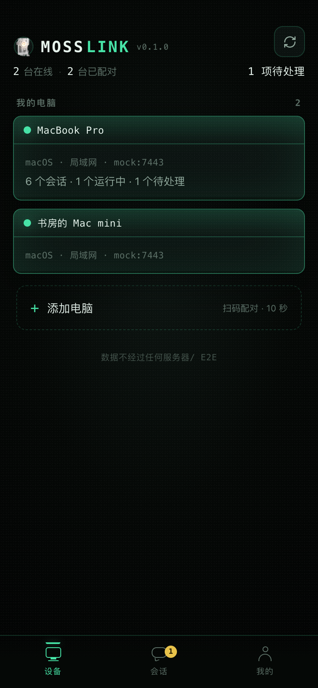

### 6. 弹层样式不统一

- **修法**：`MossSheet` 三形态 + info（菜单/确认/输入/只读），12 处调用全部替换。
- **证据**：`grep "uni.showActionSheet\|uni.showModal(" app/src` 为空。

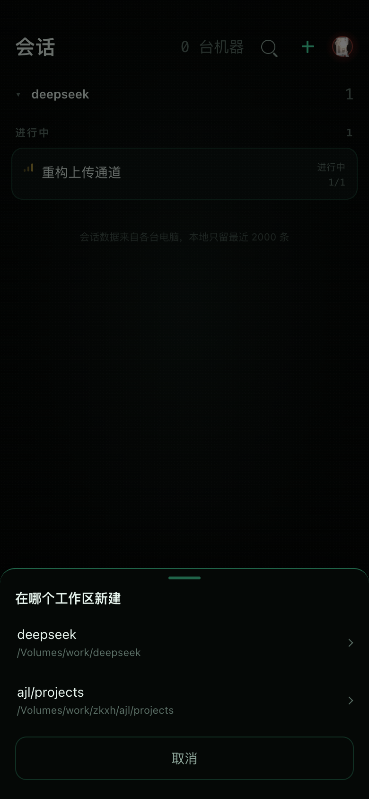

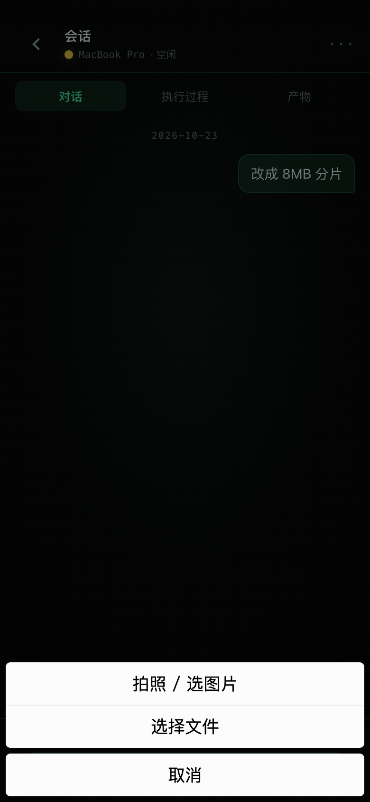

### 7. pad 横屏右栏不能收起、左栏没分组

- **修法**：右栏折叠（收起留 40px 竖排“产物”）；左栏按 `workspace.sessionIds` 分组。
- **证据**：`chat.vue` 的 `rightOpen` / `railGroups`。

### 8. 新建会话（之前完全没做）

- **根因**：协议无 `session.create`，App 无入口。
- **修法**：新增 `session.create`（operator + unlocked）；会话页 ＋ 与空态按钮。
- **证据**：`plugin/tests/session-create.test.mjs` 6 项；下方截图。

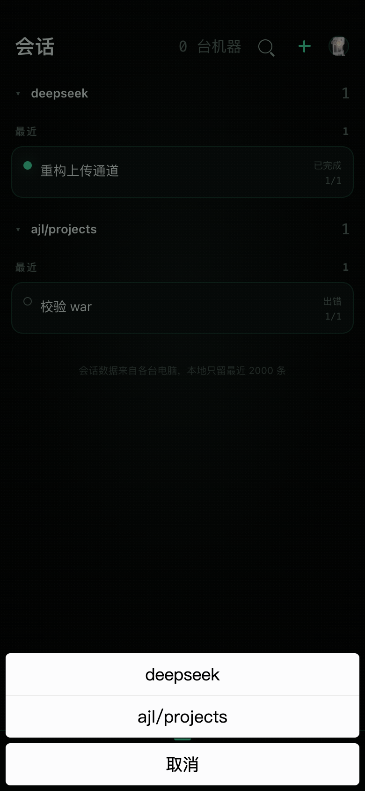

### 9. 设备/会话状态不能实时同步

- **根因**：宿主不下发 `online`，也无状态广播；列表只在 `onLoad` 拉一次。
- **修法**：`device.list` 带 `online`；`turn/start`/`turn/end` 广播 `session.status`；配对/撤销广播 `device.changed`。
- **证据**：`gateway/server.ts` 的 `onlineDeviceIds()`；`adapters/live.ts` 的广播。

### 10. 两栏宽度固定不可调

- **修法**：14px 拖拽热区，左 [180,420] / 右 [220,520]，触屏与鼠标都绑。
- **证据**：`chat.vue` 的 `startDrag` / `onDrag` / `clamp`。

---

## 三、平板与主题

**竖屏 834×1112**（单列）：

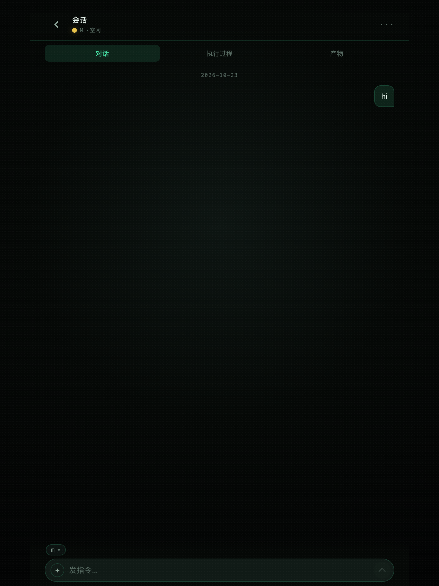

**横屏 1112×834**（三栏，两栏可拖拽）：

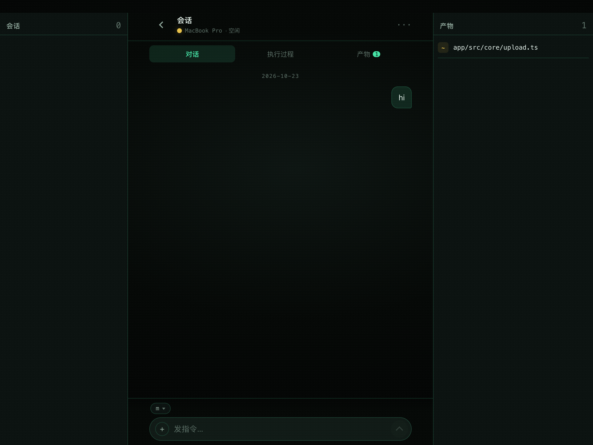

**旋转会实时重算**（不是只算一次）：

```
竖屏 834  → wide=false，无侧栏
转横屏    → wide=true，三列 810/810/810
转回竖屏  → 无侧栏
```

**浅色模式**（含滚动修复：footer 不再被 tabbar 压住）：

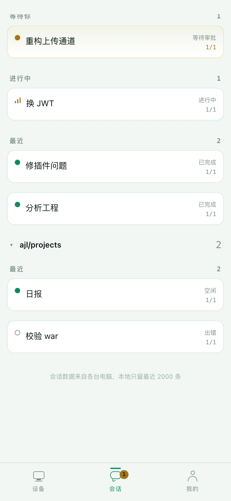

---

## 四、对话页

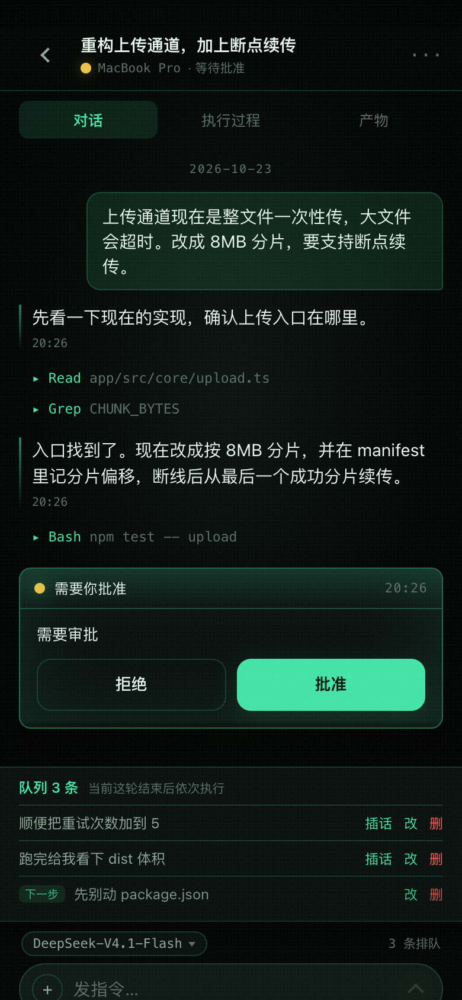

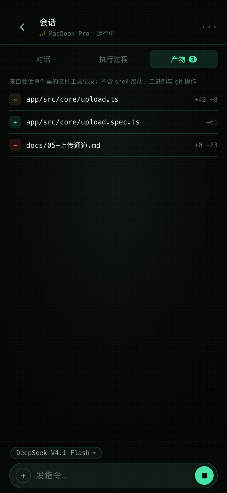

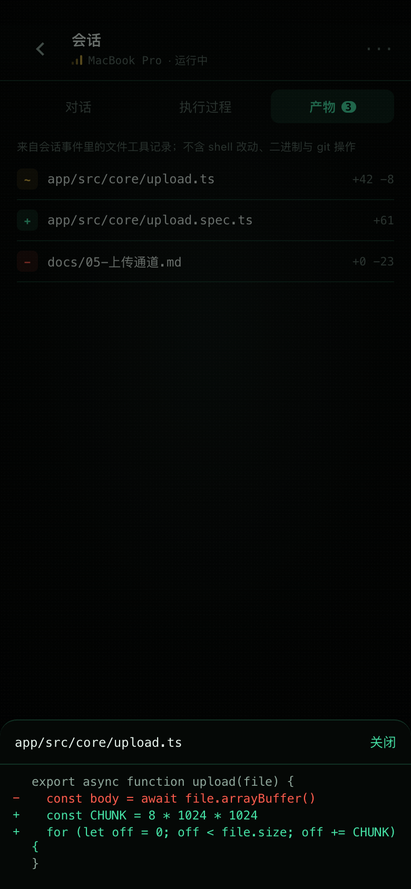

---

## 五、仍未做

| 项 | 原因 |
|---|---|
| ~~设备卡费用 + 峰谷提醒~~ | ✅ 已完成，见 §七 |
| `fs.*` / `git.*` / `plugin.*` / `chan.*` / `term.*` | M2 范围外 |
| E2E 加密 | 上公网前置条件 |
| 附件端到端 | 无头浏览器不允许文件选择器（`文件选择器对话框只能在由用户激活时显示`），需真机点一次 |
| 断线丢帧兜底 | 状态广播丢一帧会停在旧值，需补轮询 |

---

## 六、截图方法

```bash
cd app/tools/moss-render
node ui-harness.mjs              # 手机 + 平板竖 + 平板横，各 4 页
node ui-harness.mjs 390x844 --light   # 浅色
```

H5 被网关 Origin 检查挡住，连不上真实宿主，所以夹具用**替身 WebSocket**喂数据。
替身踩过的两个坑（已写进注释）：

1. uni 的 `SocketTask.send` 判断 `ws.readyState !== ws.OPEN`，只定义 `static` 常量时实例上是 `undefined`，**帧一个都发不出去**
2. `evt` 帧必须带 `seq`，否则协议层直接丢弃

---

## 七、费用与峰谷（本轮新增）

### 数据来源

全部**转发**自 `dsh-cost-meter`，不自算金额。

| 项 | 来源 | 备注 |
|---|---|---|
| 会话累计费用 | `costMeter.getSessionCost(sessionId)` | typert 清单里是**位置参数** |
| 峰谷状态 | `dsh-cost-meter/lib/pricing.js` 的 `peakPhaseAt` | `getState()` 没有峰谷字段，峰谷只体现在计费里 |

实测 `peakPhaseAt` 返回：

```json
{"inPeak":false,"weekend":false,"prevAtMs":...,"nextAtMs":...,"nextIntoPeak":true}
```

映射成 `{ peak, weekend, msUntilSwitch, next }`。

### 为什么不自算峰谷

峰谷窗口有节假日与周末特例（`DEFAULT_PEAK_HOLIDAYS`）。自己写一套必然与计费口径不一致——**给用户一个错误的省钱提醒，比不提醒更糟**。

### 未安装时

宿主没有 `cost-meter` 时返回 `{ available:false, reason }`，设备卡整块不显示。

### 模块解析的坑

插件是**链接**进 profile 的，`require.resolve('dsh-cost-meter/...')` 从仓库路径出发找不到。改为扫 `~/.dsh/profiles/*/node_modules`；实体文件在 `lib/pricing.js`（`exports` 只暴露 `.` / `./client` / `./typert`）。

### 真实宿主返回（实测）

```json
available: true
peak: {"peak":false,"weekend":false,"msUntilSwitch":216368408,"next":"peak"}
session.own: {"cost":4.8052383719999945,"costCny":34.273,  "calls":1481,
              "input":3923078,"output":762611,"cacheRead":704051200}
session: { own, subagents, subagentCount, found }
```

**关键**：金额在 `session.own.cost`（USD）/ `own.costCny`（CNY），不在 `total.amount`。我第一版按后者读，卡片上永远没有金额。

### 证据

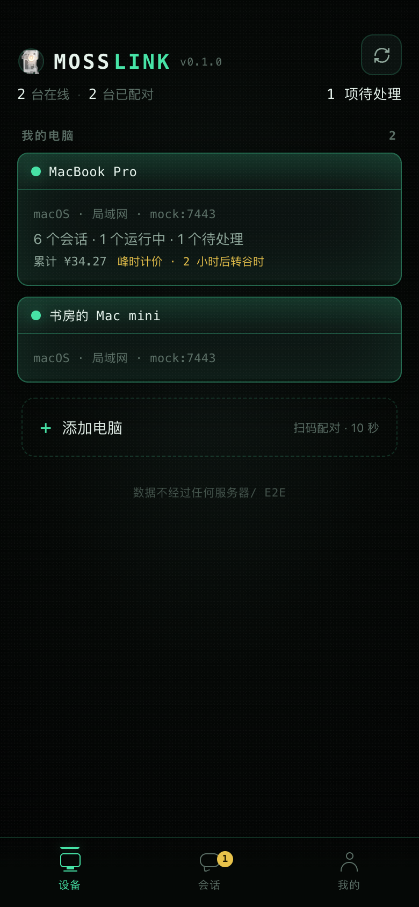

卡片第三行：`累计 ¥34.27　峰时计价 · 2 小时后转谷时`（峰时黄色、谷时绿色，周末显示"周末谷价"）。

### 重启时网关没起来的坑

重启后 HTTP 面正常但 7443 无监听。隔离启动网关是成功的，所以不是代码问题——是重启瞬间旧进程仍占着端口，新实例 `EADDRINUSE` 后被静默降级。

已加退避重试（只对 `EADDRINUSE`，300ms 起、每次 +200ms、共 6 次）。重启后确认 7443 两个地址都 `open`。

### 踩坑记录：为什么一度不显示

第一次实现后 RPC 已发出、夹具也返回了数据，但卡片上没有这一行。

根因是**模板插入失败**：我用 `<view class="dev-use">{{ usageLine(d) }}</view>` 作为锚点，而那一行早先已改成带 `v-if` 的版本，替换静默没命中。样式加上了、函数写好了、RPC 通了，唯独模板里没有这个节点。

教训：字符串替换操作用「已改过的旧文本」当锚点会**静默失败**；关键结构改动后要用 `grep` 确认节点真的存在（这次就是靠 `grep dev-cost` 只有样式没有模板才定位到）。

---

## 八、对话内容格式化（新增）

之前 agent 的回答是用 `<text>` 直接输出 Markdown 原文：`##`、`**`、```` ``` ```` 全部可见，代码块没有等宽字体、列表没有缩进。

### 实现

- `app/src/core/markdown.ts`：极简解析器，输出**结构化块**（不是 HTML 字符串）
- `app/src/components/MossMarkdown.vue`：用 view/text 逐块绘制

支持：代码块（等宽 + 横向滚动）、行内代码、标题 h1–h3、有序/无序列表、引用、分隔线、加粗、斜体、链接。

**刻意不做**：表格、嵌套缩进、内联 HTML。前两者手机上读不清，后者是攻击面。

### 为什么不引库

首包 400KB 是硬指标（docs/05 §8），marked / markdown-it 都是 30KB+ 起步，而我们只需要回答里最常见的几种结构。自写约 3KB。

### 为什么不用 rich-text

rich-text 对样式几乎不可控：代码块丢等宽字体、列表缩进按平台各异、行内代码没有底色。agent 回答里代码与列表占多数，渲染不好等于没渲染。

### 证据

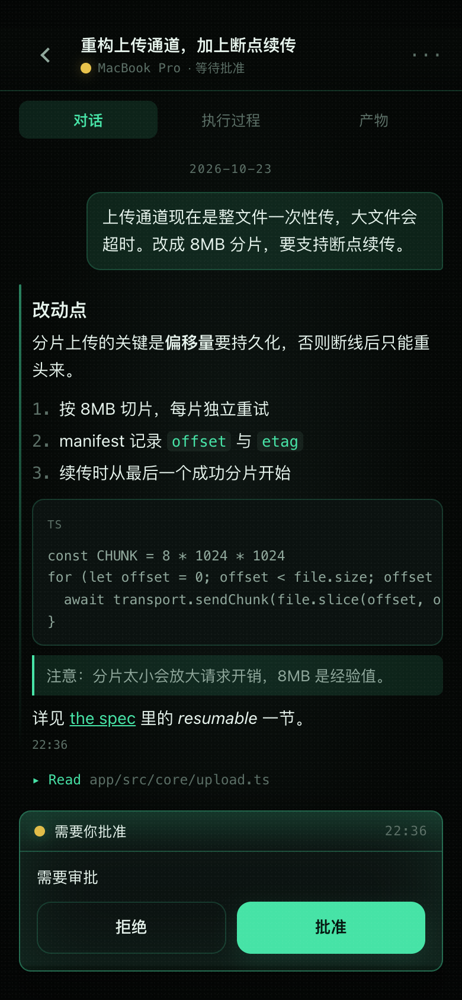

### 夹具的教训

接上 Markdown 后截图仍是空白。原因不在渲染器，而在**夹具的假适配器还在按旧结构读**（`data.text`），而真实结构是 `message.content[]`——夹具与产品代码对同一个事件用了两种读法，于是「内容为空」看起来像渲染 bug。

已把夹具适配器改成与 `adapters/sessions.ts` 一致。
